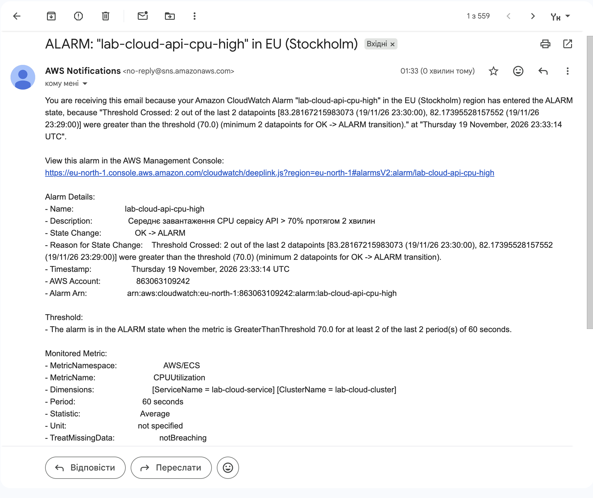
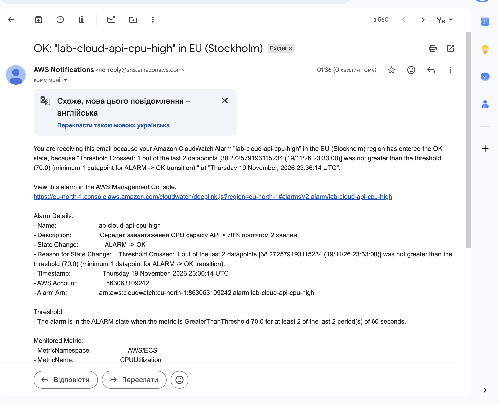

# Сповіщення

Код: [`terraform/monitoring.tf`](../terraform/monitoring.tf) — `aws_cloudwatch_metric_alarm.cpu_high`, `aws_sns_topic.alerts`, `aws_sns_topic_subscription.email_sub`.

## Умова

**Середнє завантаження CPU сервісу API (`AWS/ECS` → `CPUUtilization`, `ClusterName` + `ServiceName`) > 70 % протягом 2 хвилин поспіль.**

| Параметр | Значення |
|---|---|
| `statistic` | `Average` |
| `period` | 60 с |
| `evaluation_periods` / `datapoints_to_alarm` | 2 / 2 |
| `threshold` | 70 |
| `treat_missing_data` | `notBreaching` |
| `alarm_actions` | SNS → email (лист «ALARM») |
| `ok_actions` | SNS → email (лист «OK», повернення до норми) |

### Обґрунтування

- **Поріг 70 % вищий за ціль масштабування 60 %.** Поки автомасштабування встигає, CPU коливається біля 60 % і лист не надходить. Лист приходить, коли навантаження зростає швидше, ніж додаються екземпляри, або коли вичерпано максимум у 4 екземпляри. Саме в цих ситуаціях потрібна увага людини.
- **2 хвилини, а не одна точка.** Одиночний сплеск, наприклад GC чи деплой, не повинен будити людину. Вимога «N точок поспіль» відсікає шум і запобігає **нестабільному спрацьовуванню (flapping)**, коли метрика коливається біля порогу, а alarm перемикається ALARM ↔ OK щохвилини й засипає пошту.
- **Чому не латентність.** З погляду користувача сповіщення на p95 корисніше, бо описує те, що користувач відчуває. Але для нашого Node.js-сервісу CPU є причиною зростання латентності і реагує раніше. У реальному сервісі варто мати обидва: латентність як основний сигнал (SLO), CPU як попередження.

## Знімки листів

Обидва листи надійшли під час прогону без кешу (N = 100), 2026-11-19.

## Час реакції

| Подія | Час (UTC) |
|---|---|
| Початок навантаження | 23:25:44 |
| Початок сталого навантаження (кінець фази наростання) | 23:28:44 |
| CPU вперше > 70 % (хвилинна точка) | 23:29 (82 %), далі 83 %, 81 %, 81 % |
| Alarm перейшов у ALARM, SNS надіслав лист | 23:33:14 |
| Додано 2-й екземпляр, CPU впав до ~40 % | 23:33:56 |
| Кінець сталого навантаження | 23:33:44 |
| Alarm перейшов в OK, SNS надіслав лист OK | 23:36:14 |

**Від початку сталого навантаження до першого листа: ≈ 4,5 хв** (від першої хвилини з CPU > 70 % — ≈ 4 хв).

Лист OK надійшов через ~2,3 хв після того, як другий екземпляр зняв навантаження: потрібні дві хвилинні точки нижче порогу плюс та сама затримка публікації метрики.

Складові затримки:
1. Агрегування метрики за 1 хв і публікація в CloudWatch: ~1–2 хв.
2. Оцінювання alarm: 2 точки поспіль, тобто щонайменше 2 хв перевищення.
3. Доставка SNS → email: від кількох секунд до хвилини.

Разом **≈ 3–5 хв** від початку проблеми.

### Чи прийнятно це для реального сервісу

Для сповіщення про **перевантаження**, яке автомасштабування зазвичай виправляє саме, так. Людина однаково не відреагує швидше, ніж за 5–10 хв, а агресивніше сповіщення давало б хибні тривоги. Для **повної недоступності** (5xx, health check) 3–5 хв забагато. Там потрібні 10-секундні метрики високої роздільності або синтетичні перевірки з порогом в 1 хв і доставка в пейджер чи месенджер, а не на email.
