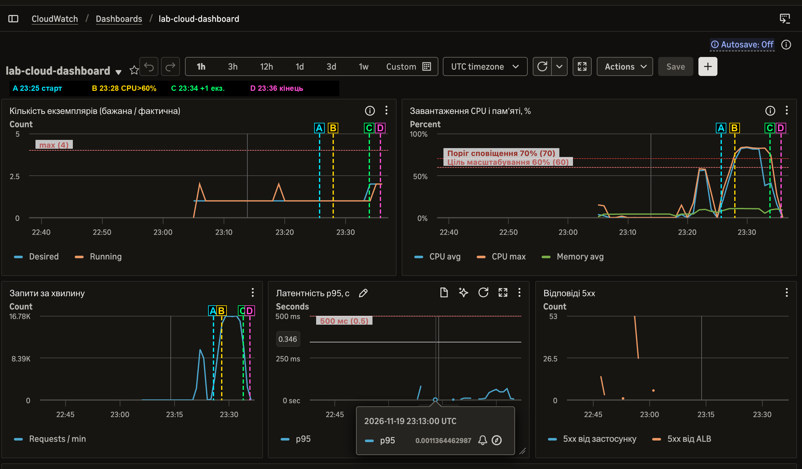
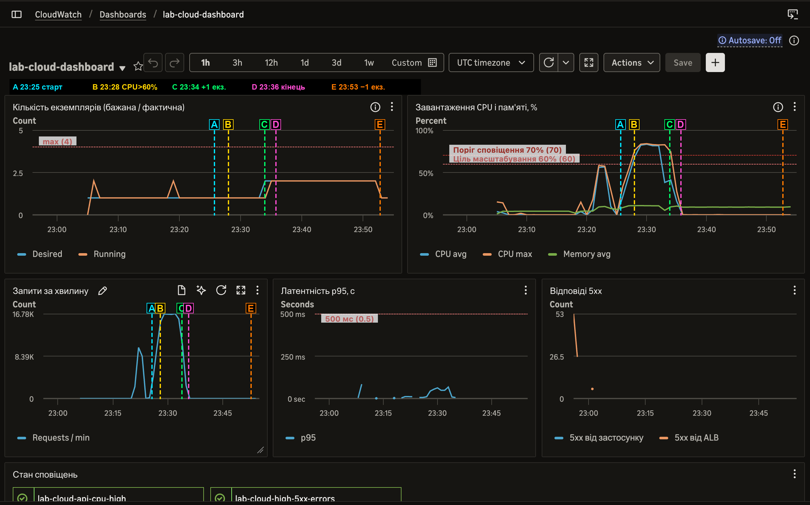

# Автоматичне масштабування

Код: [`terraform/autoscaling.tf`](../terraform/autoscaling.tf), [`terraform/dashboard.tf`](../terraform/dashboard.tf).

## Параметри політики

| Параметр | Значення | Де в Terraform |
|---|---|---|
| Тип політики | `TargetTrackingScaling` | `aws_appautoscaling_policy.api_cpu` |
| Метрика | `ECSServiceAverageCPUUtilization` (середнє CPU по всіх задачах сервісу) | там само |
| Цільове значення | **60 %** | `var.cpu_target` |
| Мінімум / максимум екземплярів | **1 / 4** | `var.min_tasks`, `var.max_tasks` (валідація ≤ 4) |
| `scale_out_cooldown` | 60 с | `aws_appautoscaling_policy.api_cpu` |
| `scale_in_cooldown` | 180 с | там само |
| Ресурси одного екземпляра | 0,25 vCPU, 512 МБ (Fargate) | `aws_ecs_task_definition.app` |
| `deregistration_delay` ALB | 30 с | `aws_lb_target_group.app` |
| `stopTimeout` контейнера | 30 с | `aws_ecs_task_definition.app` |

### Чому ціль саме 60 %

- **Запас на час реакції.** Новий екземпляр з'являється приблизно через 3–4 хвилини після того, як навантаження зросло (див. нижче). Усі ці хвилини наявні екземпляри мають «тримати» зростання. Із ціллю 60 % лишається близько 40 % запасу, тобто навантаження може зрости приблизно в 1,6 раза, доки CPU не впреться в 100 %.
- **Node.js однопотоковий.** Коли CPU наближається до 100 %, черга подій росте і латентність зростає нелінійно. Ціль 80–90 % означала б, що масштабування спрацьовує, коли p95 уже погіршився.
- **Ціль не надто низька.** Із 30–40 % сервіс тримав би вдвічі більше екземплярів, ніж потрібно, а це гроші. До того ж за малої ваги кожного екземпляра (0,25 vCPU) масштабування постійно «смикалося б».
- **Поріг сповіщення (70 %) вищий за ціль (60 %).** Лист надходить лише тоді, коли масштабування не встигає або вже вичерпано максимум. Звичайне спрацювання автомасштабування сповіщення не викликає.

**Чому не `ALBRequestCountPerTarget`.** Запити до нашого сервісу не однакові за вартістю: список з JOIN важчий за отримання за id, а з увімкненим кешем список майже нічого не коштує. Через це фіксоване «запитів на екземпляр» довелося б перепідбирати при кожній зміні коду. CPU тут чесніше показує реальне насичення, бо Node.js-процес обмежений саме CPU. Якби сервіс здебільшого чекав на БД (I/O-bound), CPU лишався б низьким при високій латентності. Тоді правильнішою метрикою була б `ALBRequestCountPerTarget` або латентність чи кількість одночасних запитів.

### Період стабілізації (cooldown)

**Cooldown** — це час після попередньої дії масштабування, протягом якого політика не виконує наступну дію того самого типу. Він потрібен, бо ефект дії видно не одразу: новий екземпляр потрібно запустити (~30–60 с на Fargate), пройти перевірку стану ALB і лише потім він почне знімати навантаження з інших. До того середнє CPU ще високе, хоча проблему вже розв'язано.

- `scale_out_cooldown = 60` с. Після додавання екземпляра наступний додається не раніше ніж за хвилину. Цього досить, щоб новий екземпляр почав приймати трафік. Target tracking при цьому може додати кілька екземплярів одразу, якщо цього вимагає формула `ceil(поточна × метрика / ціль)`.
- `scale_in_cooldown = 180` с. Вилучення навмисно повільніше: якщо помилитися з вилученням, користувачі одразу отримують гірший сервіс, а зайвий екземпляр протягом кількох хвилин коштує копійки.

**Якщо встановити cooldown = 0:**
- Масштабування вгору: політика на кожному оцінюванні бачитиме високе CPU (бо новий екземпляр ще не працює) і додаватиме ще й ще. Кількість екземплярів «перестрибне» потрібну аж до максимуму (overshoot).
- Масштабування вниз: щойно CPU впаде нижче цілі, екземпляр вилучається. Навантаження на решту зростає, CPU знову вище цілі, екземпляр додається, і так по колу. Це «пилкоподібна» поведінка (flapping, thrashing): постійні холодні старти, обірвані з'єднання, зростання p99 і зайві витрати.

### Чому між перетином порогу і появою екземпляра минає час

Ланцюжок затримок:
1. ECS публікує `CPUUtilization` раз на 1 хвилину, і в CloudWatch точка з'являється ще із затримкою ~1 хв.
2. Target tracking створює alarm `TargetTracking-…-AlarmHigh`, якому для спрацювання потрібні **3 точки поспіль по 1 хв** вище цілі. Так політика не реагує на короткі сплески.
3. Application Auto Scaling змінює `DesiredCount`, і ECS запускає задачу Fargate: виділення ресурсів, завантаження образу з ECR, старт Node.js (~30–60 с).
4. ALB має побачити 2 успішні health check з інтервалом 15 с (`healthy_threshold = 2`), перш ніж направить на екземпляр трафік.

Разом це **≈ 3–5 хвилин** від перетину порогу до моменту, коли новий екземпляр обробляє запити.

### Чому вилучення відбувається значно пізніше за падіння навантаження

- Alarm на масштабування вниз (`…-AlarmLow`) вимагає **15 точок поспіль по 1 хв** нижче ~90 % цілі. Це закладено в target tracking AWS і змінити не можна. Отже, навіть мінімальна затримка становить ~15 хв.
- Потім діє `scale_in_cooldown` (180 с) між кроками: з 3 до 1 екземпляра — два кроки.
- Вилучений екземпляр спершу від'єднується від ALB (`deregistration_delay = 30` с): ALB перестає надсилати нові запити, а поточні дочікуються. Потім ECS надсилає SIGTERM, застосунок закриває сервер, дочікується відповідей і закриває пул БД (`app/src/index.js`, функція `shutdown`). Лише після цього, або через `stopTimeout = 30` с, надходить SIGKILL.

Така асиметрія свідома: рано вилучити екземпляр означає погіршити сервіс для користувачів, а пізно вилучити — лише кілька центів.

## Знімки панелі під час прогону

Панель: CloudWatch → Dashboards → `lab-cloud-dashboard` (URL — `terraform output dashboard_url`).

Прогін без кешу, N = 100, 2026-11-19 (`docs/LOADTEST.md`). Час на знімках — UTC.

Оригінали без міток: `img/dashboard-loadtest.png`, `img/dashboard-scalein.png`.

Інші деталі на знімках:
- **Сплеск ~23:20–23:23** на графіках запитів і CPU (до ~56 %) — це калібрувальний прогін для підбору N (`docs/LOADTEST.md`). Він тривав менше за 3 хв, тому масштабування не спрацювало.
- **Короткі «зубці» Running до 2 о ~23:06 і ~23:19** — це не масштабування, а розгортання нової версії (rolling update): ECS спершу запускає новий екземпляр, а потім зупиняє старий. Desired при цьому лишається 1.
- **5xx від ALB о ~22:45–23:00** — це час одразу після `terraform apply`, коли в ECR ще не було образу і жоден екземпляр не працював. Під час навантажувального тесту 5xx не було.

| Подія | Час (UTC) | Що видно на панелі |
|---|---|---|
| A. Початок навантаження | 23:25:44 | графік 3 «Запити за хвилину» починає рости |
| B. Перетин порогу CPU 60 % | 23:28 (68 %) | графік 2: CPU avg перетинає «Ціль масштабування 60 %», далі 81–83 % |
| C. Поява нового екземпляра | 23:33:24 Desired = 2; 23:33:56 новий екземпляр у ALB | графік 1: спершу Desired, потім Running стає 2; CPU падає до ~40 % |
| D. Кінець навантаження | 23:35:46 | графік 3 падає до 0 |
| E. Вилучення екземпляра | 23:50:47 AlarmLow; 23:52:47 Desired = 1; 23:53:02 екземпляр від'єднано від ALB | графік 1: Desired/Running повертаються до 1 |

Хвилинні значення CPU (Average) за прогін: 23:26 — 21 %, 23:27 — 45 %, 23:28 — 68 %, 23:29 — 82 %, 23:30 — 83 %, 23:31 — 81 %, 23:32 — 81 %, 23:33 — 38 %, 23:34 — 41 %.

Інтервал B→C: **≈ 5,5 хв** (від першої хвилини понад 60 % до моменту, коли новий екземпляр почав приймати трафік). Це трохи довше за теоретичні 3–4 хв, бо точки `CPUUtilization` в CloudWatch з'являються із затримкою 2–3 хв, а alarm політики (3 точки поспіль) оцінює вже опубліковані точки. Інтервал D→E: **≈ 17 хв** (23:35:46 → 23:52:47). Після спаду CPU впав майже до 0, але `AlarmLow` чекав 15 хвилинних точок поспіль нижче 54 % (90 % від цілі) і перейшов у ALARM о 23:50:47. Ще ~2 хв зайняли затримка метрик і рішення політики. Потім ECS від'єднав екземпляр від ALB, дочекався поточних запитів (`deregistration_delay`) і надіслав SIGTERM.
