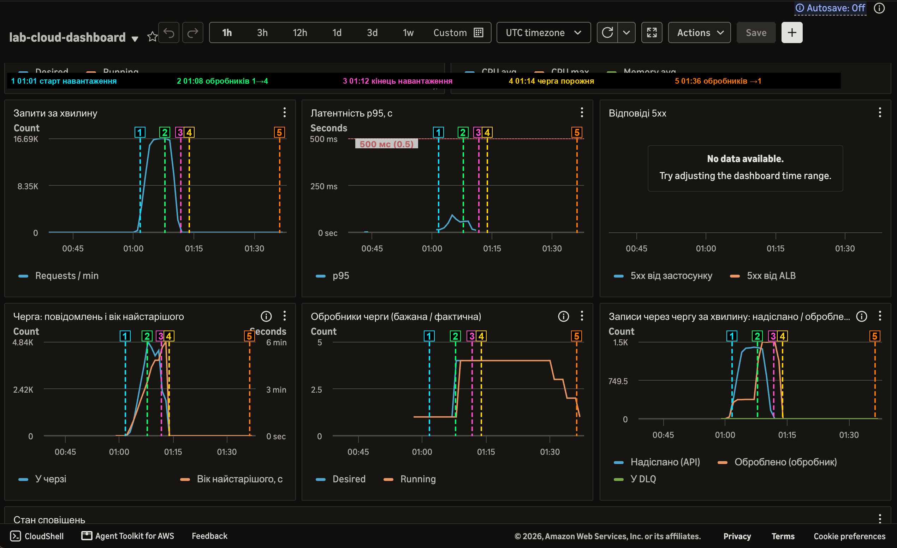

# Асинхронна обробка через чергу (бонус 6)

Код: [`terraform/queue.tf`](../terraform/queue.tf) (SQS + DLQ, ролі задач, сервіс-обробник, масштабування), [`app/src/index.js`](../app/src/index.js) (`WRITE_MODE=queue`, `GET /api/requests/{id}`), [`app/src/worker.js`](../app/src/worker.js) (обробник).

## Архітектура

```text
клієнт ──POST /api/notes──▶ API (ECS, за ALB)
   ▲                         │ 1. SendMessage {requestId, content, authorId}
   │ 202 Accepted            │ 2. Redis: job:<requestId> = pending
   │ Location: /api/requests/<requestId>
   │                         ▼
   │                  SQS lab-cloud-writes ──(5 невдалих спроб)──▶ DLQ lab-cloud-writes-dlq
   │                         │ long polling, до 10 повідомлень
   │                         ▼
   │                  обробник (ECS lab-cloud-worker, 1–4 задачі)
   │                         │ 3. «тривала операція» (WORKER_PROCESS_MS = 150 мс)
   │                         │ 4. INSERT … ON CONFLICT (idempotency_key = requestId)
   │                         │ 5. Redis: job:<requestId> = done, noteId
   │                         │ 6. DeleteMessage
   └──GET /api/requests/<id>─┘  → {"status":"done","noteId":…}  → GET /api/notes/<noteId>
```

- Режим вмикає змінна Terraform `write_mode = "queue"` (за замовчуванням). З `sync` поведінка лаб. 1–2 повертається: `201` із записом.
- Обробник — **той самий образ**, що й API, з іншою командою: `node src/worker.js`. Він оновлюється тим самим CI/CD, бо workflow перезапускає обидва сервіси.
- Права за принципом найменших привілеїв (ролі задач, без ключів): API — лише `sqs:SendMessage` в одну чергу; обробник — лише `ReceiveMessage`/`DeleteMessage`/`ChangeMessageVisibility` з неї.
- «Тривала операція» — штучна затримка 150 мс на повідомлення. Вона імітує, наприклад, модерацію, індексацію чи генерацію прев'ю. Без неї запис у БД займає кілька мілісекунд, і один обробник встигав би за будь-яким потоком, тож масштабування від довжини черги не було б видно.

## Що змінилося для клієнта

| | Синхронно (`201 Created`) | Через чергу (`202 Accepted`) |
|---|---|---|
| Відповідь | готовий запис з `id` | `{"requestId", "status":"pending", "statusUrl"}` + заголовок `Location` |
| Що гарантує | запис уже в БД | запит прийнято й збережено в черзі; запис з'явиться пізніше |
| Час відповіді | залежить від БД і тривалої операції | лише час `SendMessage` (~10–20 мс), не залежить від навантаження на обробник |
| Помилка обробки | клієнт одразу бачить 5xx | клієнт дізнається зі статусу; повідомлення повторюється, потім іде в DLQ |
| Читання щойно створеного | одразу | лише після `status = done` (eventual consistency) |

**Як клієнт дізнається результат:** опитує `GET /api/requests/{requestId}` (polling). Відповідь — `pending`, або `done` з `noteId` і заголовком `Location: /api/notes/{noteId}`. Сценарій k6 робить до 3 опитувань з паузою і, якщо запис ще не готовий, просто йде далі. Альтернативи polling: webhook (сервер викликає URL клієнта), WebSocket або Server-Sent Events, лист чи push-сповіщення.

## Доставка «щонайменше один раз» і повторна обробка

**At-least-once:** SQS не видаляє повідомлення, коли обробник його отримав. Воно стає невидимим на `visibility_timeout_seconds = 60`. Обробник видаляє його (`DeleteMessage`) лише **після** успішного запису. Якщо обробник упав, його вилучило масштабування або він не встиг за 60 с, повідомлення знову стає видимим і приходить повторно. Повідомлення не губиться, але може прийти двічі. Після 5 невдалих спроб воно переходить у DLQ, щоб «отруйне» повідомлення не блокувало чергу безкінечно.

**At-most-once** — навпаки: видалити повідомлення одразу після отримання. Тоді дублів немає, але збій посеред обробки = втрачений запис. Черги зазвичай дають at-least-once, бо втрату даних неможливо виправити, а дубль можна відсіяти ідемпотентністю.

**Що буде при повторній обробці:** `requestId` з повідомлення записується в `notes.idempotency_key` (UNIQUE), а вставка виконується як `INSERT … ON CONFLICT (idempotency_key) DO UPDATE … RETURNING id, (xmax = 0) AS inserted`. Друга обробка того самого повідомлення не створює новий рядок, а повертає наявний. Обробник пише в журнал `{"type":"duplicate", …}`, ставить той самий статус `done` з тим самим `noteId` і видаляє повідомлення.

Перевірка локально (ElasticMQ): те саме повідомлення надіслано в чергу двічі:

```text
worker-1  | {"type":"duplicate","requestId":"redelivery-demo-1","noteId":11,"receiveCount":"1"}
$ psql … -c "select count(*) from notes where idempotency_key='redelivery-demo-1'"
1
```

Подробиці і зв'язок з `Idempotency-Key` — у [`docs/IDEMPOTENCY.md`](IDEMPOTENCY.md).

## Масштабування обробника від довжини черги

Target tracking за метрикою **«повідомлень на одного обробника»** (backlog per task), як радить AWS для обробників черг:

```text
backlog = ApproximateNumberOfMessagesVisible (AWS/SQS) / RunningTaskCount (ECS/ContainerInsights, worker)
ціль    = 50 повідомлень на обробник, min 1, max 4, scale-out cooldown 60 с, scale-in 120 с
```

Чому так, а не просто «довжина черги»: target tracking припускає, що метрика падає пропорційно до кількості задач. Довжина черги сама від кількості обробників не залежить, а черга на одного обробника — залежить. Ціль 50 при ~6 повідомленнях/с на обробник — це ~8 с очікування в черзі.

## Прогін навантаження

`LABEL=queue ./loadtest/run.sh <alb> 100`, 2026-11-20 01:01:40–01:11:43 UTC; `write_mode = queue`, кеш увімкнено. Сирі дані — `loadtest/results/queue.json`.

| Показник | Синхронно, з кешем (`docs/CACHE.md`) | Через чергу |
|---|---|---|
| Запитів / за секунду | 127 111 / 211,4 | 125 839 / 208,8 |
| Частка помилок | 0 % | 0 % |
| p50 / p95 / p99 (k6) | 34,3 / 120,8 / 162,4 мс | 36,4 / 125,2 / 200,7 мс |
| p95 на ALB, стале навантаження, 1 екземпляр API | 26–39 мс | 49–92 мс (див. нижче) |
| Записів через чергу | — | 10 495 надіслано, 0 у DLQ |
| Дублів при обробці | — | 0 (повторних доставок не було) |

Хронологія за хвилинами (UTC):

| Хв | Надіслано в чергу | Оброблено | У черзі (макс.) | Вік найстарішого, с | Обробників | API: CPU / екземплярів | p95 ALB, мс |
|---|---|---|---|---|---|---|---|
| 01:02 | 401 | 321 | 0 | 0 | 1 | 37 % / 1 | 15 |
| 01:03 | 870 | 374 | 175 | 27 | 1 | 58 % / 1 | 24 |
| 01:04 | 1 295 | 373 | 767 | 59 | 1 | 74 % / 1 | 49 |
| 01:05 | 1 375 | 377 | 1 721 | 97 | 1 | 80 % / 1 | 92 |
| 01:06 | 1 381 | 376 | 2 736 | 138 | 1 | 77 % / 1 | 70 |
| 01:07 | 1 394 | 376 | 3 696 | 175 | 1 → 4 (Desired о 01:07:50) | 77 % / 1 | 55 |
| 01:08 | 1 385 | 1 147 | 4 841 | 214 | 4 | 77 % / 1 | 58 |
| 01:09 | 1 359 | 1 499 | 4 540 | 265 | 4 | 39 % / 1 → 2 | 59 |
| 01:10 | 824 (спад) | 1 492 | 4 126 | 291 | 4 | 37 % / 2 | 17 |

Що видно:
1. **Латентність API не залежить від черги.** Поки черга росла від 0 до ~4 800 повідомлень і найстаріше чекало вже майже 5 хв, p95 на ALB тримався в одному коридорі 50–90 мс, а не ріс разом із чергою. `POST` лише кладе повідомлення в SQS. Абсолютне значення вище, ніж у синхронному прогоні з кешем, з двох причин: кожен клієнт ще й опитує статус (+до 3 запитів на ітерацію), а `SendMessage` у SQS додає ~10–20 мс. Через це CPU API досяг 77–80 %, і масштабування API (`docs/AUTOSCALING.md`) додало другий екземпляр.
2. **Обробник масштабувався від довжини черги.** Один обробник стабільно робить ~375 повідомлень/хв (~6,2/с при 150 мс на повідомлення), а надходило ~1 380/хв. Backlog на обробник перевищив ціль 50 уже на 01:03–01:04, а Desired = 4 встановлено о 01:07:50. Затримка ~4 хв: метрики SQS публікуються раз на хвилину із запізненням, а target tracking чекає 3 точки поспіль. З 4 обробниками пропускна здатність ~1 500/хв > 1 380/хв надходження, і черга почала зменшуватися ще під навантаженням.
3. **Ціна асинхронності — затримка до появи запису.** На піку запис з'являвся в БД через ~3,5–5 хв після `202` (середня затримка обробки за журналом — до 214 с, вік найстарішого — до 291 с). Тому в k6 більшість записів (10 299 з 10 490) не були готові після 3 опитувань — це очікувано для такого навантаження. Вимірювання `write_completion_ms` у k6 (p50 410 мс) враховує лише записи, що встигли до 3-го опитування, тобто переважно з початку тесту, тож показовішими тут є метрики SQS. Більше обробників (або без штучних 150 мс) — і затримка падає до секунд.



Мітки (UTC): **1** 01:01 — старт навантаження; **2** 01:08 — обробників 1 → 4; **3** 01:12 — кінець навантаження; **4** 01:14 — черга порожня; **5** 01:36 — обробників знову 1. Між 1 і 3 черга (графік «Черга») росте до ~4,8 тис. повідомлень, а p95 (графік «Латентність») лишається в тому самому коридорі, далеко нижче 500 мс. На графіку «5xx» — No data: помилок не було. Оригінал без міток — `img/dashboard-queue.png`.

Після тесту (UTC):

| Час | Подія |
|---|---|
| 01:11:43 | k6 завершився |
| 01:13:53 | черга спорожніла (4 обробники розібрали залишок ~4 100 повідомлень за ~3 хв) |
| 01:30:17 | обробники 4 → 3 (AlarmLow: 15 хвилинних точок поспіль нижче цілі) |
| 01:30:47 | API 2 → 1 |
| 01:33:17 | обробники 3 → 2 (`scale_in_cooldown = 120` с між кроками) |
| 01:36:17 | обробники 2 → 1 — усе повернулося до мінімуму |

DLQ після тесту порожня: жодне повідомлення не впало 5 разів поспіль.
